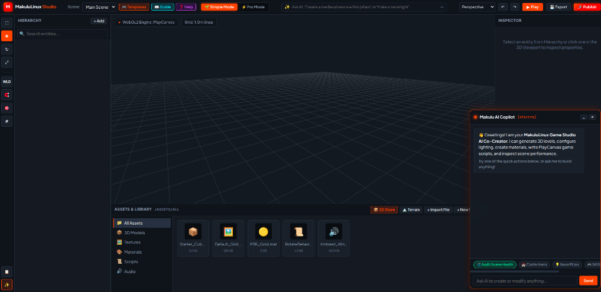
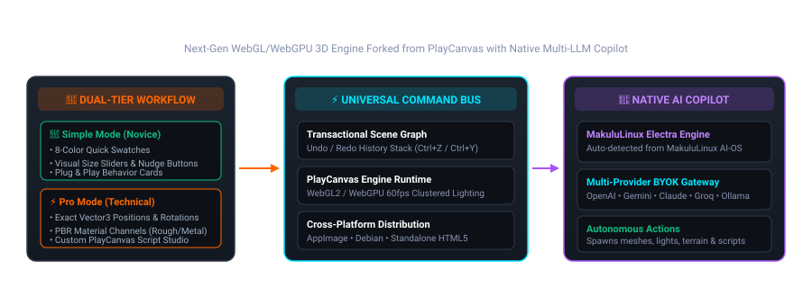

<div align="center">


# 🎮 MakuluLinux Game Studio
### Next-Generation AI-First 3D Game Engine & Desktop/Web Studio Editor
**Forked & Engineered on top of the PlayCanvas WebGL/WebGPU 3D Engine**

[](LICENSE)
[](#cross-distro-desktop-packaging)
[](https://playcanvas.com)
[](#-native-ai-studio-copilot)
[](#-building-and-packaging)

<br/>



</div>

---

## 🌟 Executive Overview

**MakuluLinux Game Studio** is a professional, high-performance, AI-native 3D game creation suite designed to make AAA-grade game development accessible to novices while giving experienced developers technical depth.

Built upon a dual architecture (**Web Standards + Native Electron Shell**), the studio runs seamlessly across all Linux distributions (MakuluLinux, Ubuntu, Debian, Fedora, Arch, openSUSE) as a self-contained zero-install **AppImage** and native **Debian (`.deb`)** package, as well as on Windows, macOS, and standard modern web browsers.

### 🏛️ PlayCanvas Engine Heritage
MakuluLinux Game Studio is proudly **forked from and built upon the open-source PlayCanvas WebGL2/WebGPU engine**. By leveraging PlayCanvas's battle-tested 60fps rendering pipeline, clustered lighting, physical PBR shaders, and lightweight memory footprint, games created in MakuluLinux Studio load in milliseconds and run at high framerates on desktop PCs, laptops, and mobile devices without requiring heavyweight runtime installs or browser plugins.

---

## 🏗️ Core Architecture

<div align="center">
  
</div>

The studio is organized into five unified subsystems:
1. **Interactive 5-Pane Docked Interface:** A docked layout modeled after industry standards (Unity, Unreal, PlayCanvas) with customizable resizable splitters.
2. **Dual-Tier Workflow (🌱 Simple vs ⚡ Pro):** Switch effortlessly between beginner visual creation and technical Entity-Component-System (ECS) engineering.
3. **Universal Command Bus:** Transactional action bus providing full Undo/Redo (`Ctrl+Z`, `Ctrl+Y`) for both user clicks and autonomous AI modifications.
4. **Native AI Studio Copilot:** Connected to MakuluLinux Electra AI, OpenAI, Google Gemini, Anthropic Claude, Groq, Mistral, Moonshot, and local Ollama instances.
5. **Zero-Install Game Compiler:** Bundles entire 3D games into a single `.html` file that can be double-clicked on any computer or phone to play instantly.

---

## 🖥️ 5-Pane Studio Interface

```
┌────────────────────────────────────────────────────────────────────────────────────────────────────────────────────────┐
│ [M] MakuluLinux Studio | File ▾ | Scene ▾ | Tools ▾ | Settings ▾ | Help ▾ | Scene: [Main Scene ▾] | [🌱 Simple / ⚡ Pro]  │
├─────────┬──────────────────────────────────────────────────────────────────────────────────────────────┬───────────────┤
│ HIER-   │ 3D VIEWPORT                                                                                  │ INSPECTOR     │
│ ARCHY   │                                                                                              │               │
│         │   • Infinite 3D Floor Grid & Coordinate Axes                                                │ [🌱 Simple /  │
│ [Search]│   • PlayCanvas 3D Gizmos (W: Move, E: Rotate, R: Scale)                                      │  ⚡ Pro Mode]  │
│         │   • Atmosphere Sky Presets (Day, Sunset, Cyberpunk, Foggy, Night) + ✨ FX Post-Processing    │               │
│ + Add   │   • Smooth Orbit, Pan, Zoom, WASD Flythrough, Framing (F)                                    │ • Transforms  │
│  ├ Cube │   • Drag-and-Drop Reparenting in Scene Hierarchy                                             │ • Materials   │
│  ├ Sun  │   • Visual Wireframe Helpers (Light Range, Audio Radius, Collision Boxes)                    │ • Prefabs     │
│  └ Cam  │                                                                                              │ • ECS Cards   │
├─────────┴──────────────────────────────────────────────────────────────────────────────────────────────┴───────────────┤
│ ASSETS & CODE STUDIO                                                                                                   │
│ [📁 All] [📦 Prefabs] [📦 3D Store] [🏔️ Terrain Sculptor] [🎨 Material Studio] [📜 Script Studio] [🩺 Console Drawer] │
└────────────────────────────────────────────────────────────────────────────────────────────────────────────────────────┘
```

1. **Hierarchy Panel (Left):** Real-time scene graph with instant search, tree nesting, visual **drag-and-drop reparenting**, and the `+ Add` menu for primitives, lights, cameras, particles, and audio.
2. **Interactive 3D Viewport (Center):** High-DPI canvas with an infinite procedural floor grid, raycast picking, transform gizmos, live **Interactive Corner Hook Arrows** for real-time drag-resizing of 3D models, on-canvas **Floating Transform Toolbar** (`✥ Move`, `↻ Rotate`, `⤢ Resize`, `➕ Enlarge`, `➖ Shrink`), live **Component Visual Wireframe Helpers** (light ranges, audio radius, collision bounding shapes), and real-time **Atmosphere & Fog Sky selector** with **✨ FX Post-Processing**.
3. **Inspector Panel (Right):** Morphing property editor that automatically adapts based on whether you are in Simple or Pro Mode, with **1-click Prefab Creation** and complete ECS component stacks for Cameras, Collisions, Rigidbodies, Particles, Spatial Audio, and Scripts.
4. **Asset Browser & Code Studio (Bottom):** Integrated project file explorer with dedicated `/assets/prefabs` support, authentic CC0 3D model importer, procedural Perlin terrain generator, visual PBR material studio, and Monaco-style script editor.
5. **Top Navigation & Menu Bar:** Streamlined, uncluttered desktop menu bar (`File ▾`, `Scene ▾`, `Tools ▾`, `Settings ▾`, `Help ▾`), Scene quick switcher, Simple/Pro switcher, AI Quick Prompt bar, Atmosphere selector, Post-Processing FX, Undo/Redo, Play/Simulate mode, and 1-Click Web Publishing.

---

## 🌱 Dual-Tier Workflow: Simple vs. Pro Mode

MakuluLinux Game Studio introduces a breakthrough dual-tier interface, allowing beginners to create without being overwhelmed by technical jargon, while giving engineers access to raw engine mechanics:

| Feature | 🌱 Simple Mode (Novices) | ⚡ Pro Mode (Engineers) |
| :--- | :--- | :--- |
| **Material Coloring** | **8-Color Quick Swatches:** Red, Orange, Amber, Emerald, Cyan, Cobalt, Purple, Obsidian | **PBR Material Preview Sphere:** Real-time 3D orbiting sphere with Diffuse, Metalness, and Roughness sliders |
| **Transform & Sizing** | **Visual Size Sliders & ±0.5 Nudge Buttons:** Move objects with arrows, scale smoothly from 0.1x to 10x | **Exact Vector3 Coordinate Inputs:** Float precision Position [X, Y, Z], Rotation [Pitch, Yaw, Roll], and Scale |
| **Gameplay Logic** | **Plug & Play Behavior Cards:** 1-Click activate WASD Player Controller, Continuous Spin, or Torch Flicker | **Component Stack & Script Studio:** Custom PlayCanvas script attachments, lifecycle hooks (`initialize`, `update`), and raw ECS components |
| **Lighting** | **Visual Light Swatches:** Instant amber, cyan, white, red fixtures with visible fixture bodies | **Light Physics:** Inner/outer cone angles, range, attenuation, real-time shadow cascades |

---

## 🤖 Native AI Studio Copilot

The MakuluLinux AI Copilot is an autonomous co-creator connected directly to the studio's **Universal Command Bus**. The AI does not merely generate chat text; it can directly create 3D meshes, position lights, sculpt mountains, and debug code.

### 🔑 Dynamic Credential Auto-Detection (Zero Configuration)
- **On MakuluLinux AI-OS:** When launched on MakuluLinux, the studio automatically detects and loads the user's Electra credentials from `~/.config/ai_terminal/electra_auth.json`. The user never has to copy-paste or enter API keys.
- **On Other Distros (Ubuntu, Arch, Fedora) or Web:** If no system key is found, users can enter their Electra AI key or choose from a wide range of external AI providers in the **⚙️ AI Settings** menu.

### 🌐 Supported AI Providers & Models
Users can configure their own API keys (Bring-Your-Own-Key) with local, private `localStorage` persistence:
* **🐧 MakuluLinux Electra:** `electra-nano` (rapid sub-second scene commands) and `electra` (complex architecture synthesis).
* **⚡ OpenAI:** `gpt-4o`, `gpt-4o-mini`, `o3-mini`, `gpt-4-turbo`.
* **✨ Google Gemini:** `gemini-2.0-flash`, `gemini-1.5-pro`, `gemini-1.5-flash`, `gemini-2.5-pro-exp`.
* **🧠 Anthropic Claude:** `claude-3-5-sonnet-20241022`, `claude-3-5-haiku-20241022`, `claude-3-opus-20240229`.
* **⚡ Groq Cloud (Ultra-Fast LPU):** `llama-3.3-70b-versatile`, `llama-3.1-8b-instant`, `deepseek-r1-distill-llama-70b`.
* **🌙 Kimi (Moonshot AI):** `moonshot-v1-8k`, `moonshot-v1-32k`, `moonshot-v1-128k`.
* **🌪️ Mistral AI:** `mistral-large-latest`, `codestral-latest` (dedicated game code model).
* **🔮 MiniMax / Mimo:** `MiniMax-Text-01`, `abab6.5s-chat`.
* **🌐 OpenRouter:** Multi-model gateway (`openrouter/auto`, `deepseek/deepseek-chat`, etc.).
* **💻 Custom / Local AI (Offline):** Connect directly to local **Ollama**, **LM Studio**, or **vLLM** (`http://localhost:11434/v1/chat/completions`).

### 🛠️ Autonomous AI Action Capabilities
The AI Executor translates natural language intent into direct engine modifications with full undo history:
* **Procedural Architectural Construction:** Build complete modular rooms, combat arenas, spiral staircases, and cylindrical towers with collisions via `build_architecture`.
* **Scene & Level Management:** Create, duplicate, rename, delete, switch (`switch_scene`), audit, and auto-repair scenes (`audit_scene`).
* **Transform & Camera Framing:** Translate, rotate (Euler angles), scale, select (`select_entity`), and frame target entities in the 3D viewport (`frame_entity`).
* **Material Engineering & Presets:** Generate custom PBR materials or apply instant presets (`gold`, `neon`, `lava`, `wood`, `metal`, `emerald`, `glass`) via `apply_material_preset`.
* **Behavior Injection:** Attach any of the **150 interactive No-Code gameplay behaviors** (`jump_pad_launch_booster`, `laser_security_tripwire`, `shield_bubble_barrier`, `zipline_traversal_slide`, `stealth_grass_hiding_bush`, `time_bomb_countdown`, `grav_repulsor_shockwave`, `heat_seeking_homing_missile`, `interactive_vending_machine`, `portal_gun_spatial_pair`, `slow_motion_dodge_roll`, `boss_phase3_meteor_rain`, `visual_flow_graph`, `reflection_probe_cubemap`, `vehicle_suspension_physics`, `procedural_chain_rope_physics`, `cinematic_camera_rail`, `interactive_switch_toggle`, `weapon_overheat_system`, `quest_journal_tracker`, `inventory_quick_slot_bar`, `grappling_hook_physics_swing`, `enemy_boss_phase_transition`, `procedural_spline_mesh_deformer`, `screen_space_impact_vfx`, `interactive_inventory_chest`, `wall_run_controller`, `third_person_controller`, `navmesh_agent`, `crouch_stealth_mechanic`, `grappling_hook_rope_beam`, `procedural_water_ripple`, `enemy_boss_healthbar_hud`, `screen_blood_vignette`, `telekinesis_gravity_lift`, `procedural_ik_footing`, `time_rewind_effect`, `stealth_invisibility_cloak`, `thermal_night_vision_toggle`, `stamina_system`, `footstep_audio`, `item_magnet`, `turret_laser_sight`, `grappling_rope_physics`, `portal_teleport_pair`, `tactical_time_dilation`, `dynamic_weather_storm`, `loot_box_gacha`, `magnetic_shield`, `grappling_hook`, `grav_gun_physicshandler`, `gravity_well_attractor`, `flashlight_battery`, `waypoint_flight_path`, `boss_ai`, `cover_system`, `quest_tracker`, `sway_foliage`, `exploding_barrel`, `damage_flash`, `slow_motion_zone`, etc.).
* **Visual Shader & Flow Node Graphing:** Create and apply procedural node-based materials via `create_shader_graph`, or author event logic flow graphs via `create_flow_graph`.
* **HDRI, Terrain Sculpting & Joint Rigging:** Configure 360° environment lighting via `set_hdri_skybox`, sculpt heightmaps via `sculpt_terrain_heightmap`, configure physics joint linkages via `configure_joint`, or launch any studio editor modal via `open_tool_modal`.
* **Procedural Level Prefabs & Combat FX:** Spawn reactive bounce pads (`create_jump_pad`), security alarm beams (`create_security_tripwire`), protective forcefields (`create_shield_bubble`), aerial traverse lines (`create_zipline`), timed explosives (`create_time_bomb`), or trigger dynamic radial shockwaves (`trigger_radial_shockwave`).
* **HUD & Atmosphere Control:** Configure 2D HUD screens via `set_hud_config`, switch sky presets (Day, Sunset, Cyberpunk, Foggy, Night) or adjust exposure, fog density, and fog color via `set_postfx`.
* **Instant Particle & Light Generation:** Procedurally generate pre-tuned particle systems (`create_particle_preset`) or styled physical light fixtures (`create_light_fixture`).
* **Environmental Volumes:** Procedurally spawn buoyant water volumes (`create_water_volume`) or hazardous lava/acid zones (`create_hazard_zone`).
* **Physics, Constraints & Ragdolls:** Dynamically attach Rigidbody, Collision, 6-DOF / Hinge / Ball Physics Joint constraints, and ragdoll defeat collapses.
* **Component Engineering:** Attach Rigidbody, Collision, Light, Render, Audio (`add_sound`), and Particle (`add_particle_system`) components.
* **Animation State Machines:** Configure 2D/3D state blend trees and parameter conditions via `configure_anim_blend`.
* **Consulting the Skills Library:** Consult any of the **64 standardized micro-skills** via `consult_skill` before performing complex operations.

---

## 🧠 Standardized Agent Skills Library (64 Micro-Skills)

Modeled after the leading AI agent specifications ([addyosmani/agent-skills](https://github.com/addyosmani/agent-skills) and [mattpocock/skills](https://github.com/mattpocock/skills)), MakuluLinux Game Studio features a comprehensive, microscopic library of **64 standardized agent skills** in [`/skills`](./skills/README.md).

Both autonomous coding agents (Google Jules, Antigravity, Claude Code, Cursor) and the In-Editor AI Copilot follow these skills before modifying code or scenes, ensuring consistent, non-hallucinating, bug-free execution:

* 📖 **[Master Skills Directory & Catalog](./skills/README.md)**
* 📚 **[The Complete Skillbook Reference](./skills/SKILLBOOK.md)**
* ⚙️ **[Machine-Readable Skills Index](./skills/index.json)**

### 📂 Skill Domains & Coverage:
1. **📦 3D Models & Meshes (8 skills):** [`spawn-3d-model`](./skills/spawn-3d-model/SKILL.md), [`resize-3d-model`](./skills/resize-3d-model/SKILL.md), [`spawn-primitive`](./skills/spawn-primitive/SKILL.md), [`transform-entity`](./skills/transform-entity/SKILL.md), [`duplicate-and-delete`](./skills/duplicate-and-delete/SKILL.md), [`manage-hierarchy`](./skills/manage-hierarchy/SKILL.md), [`prefab-system`](./skills/prefab-system/SKILL.md), [`procedural-terrain`](./skills/procedural-terrain/SKILL.md).
2. **💃 Character Locomotion & Skeletal Animation (6 skills):** [`glb-skeletal-rigging`](./skills/glb-skeletal-rigging/SKILL.md), [`character-locomotion`](./skills/character-locomotion/SKILL.md), [`procedural-limb-animation`](./skills/procedural-limb-animation/SKILL.md), [`inspector-animation-player`](./skills/inspector-animation-player/SKILL.md), [`anim-blend-graph`](./skills/anim-blend-graph/SKILL.md), [`timeline-keyframe-sequencer`](./skills/timeline-keyframe-sequencer/SKILL.md).
3. **🎨 Materials & Texture Compression (3 skills):** [`configure-pbr-material`](./skills/configure-pbr-material/SKILL.md), [`apply-material-presets`](./skills/apply-material-presets/SKILL.md), [`texture-compression-pipeline`](./skills/texture-compression-pipeline/SKILL.md).
4. **☀️ Lighting, Atmosphere & PostFX (4 skills):** [`configure-lights`](./skills/configure-lights/SKILL.md), [`skybox-and-atmosphere`](./skills/skybox-and-atmosphere/SKILL.md), [`fog-and-postfx`](./skills/fog-and-postfx/SKILL.md), [`light-flicker-and-cycle`](./skills/light-flicker-and-cycle/SKILL.md).
5. **⚙️ Physics, Colliders & Joints (4 skills):** [`configure-rigidbody-physics`](./skills/configure-rigidbody-physics/SKILL.md), [`physics-collision-shapes`](./skills/physics-collision-shapes/SKILL.md), [`physics-joint-constraints`](./skills/physics-joint-constraints/SKILL.md), [`ragdoll-physics`](./skills/ragdoll-physics/SKILL.md).
6. **🎮 Player Controllers & Traversal (7 skills):** [`wasd-player-controller`](./skills/wasd-player-controller/SKILL.md), [`first-person-controller`](./skills/first-person-controller/SKILL.md), [`jetpack-controller`](./skills/jetpack-controller/SKILL.md), [`wall-run-controller`](./skills/wall-run-controller/SKILL.md), [`grappling-hook`](./skills/grappling-hook/SKILL.md), [`vehicle-controller`](./skills/vehicle-controller/SKILL.md), [`dash-boost`](./skills/dash-boost/SKILL.md).
7. **⚔️ AI Enemies, Combat & Weapons (10 skills):** [`enemy-ai`](./skills/enemy-ai/SKILL.md), [`boss-ai`](./skills/boss-ai/SKILL.md), [`patrol-and-waypoints`](./skills/patrol-and-waypoints/SKILL.md), [`turret-ai`](./skills/turret-ai/SKILL.md), [`stealth-ai`](./skills/stealth-ai/SKILL.md), [`enemy-spawner`](./skills/enemy-spawner/SKILL.md), [`health-and-damage`](./skills/health-and-damage/SKILL.md), [`shield-generator`](./skills/shield-generator/SKILL.md), [`cover-system`](./skills/cover-system/SKILL.md), [`projectile-shooter`](./skills/projectile-shooter/SKILL.md).
8. **🚪 Interactive World & Triggers (6 skills):** [`interactive-doors-and-keys`](./skills/interactive-doors-and-keys/SKILL.md), [`moving-platforms`](./skills/moving-platforms/SKILL.md), [`pressure-plates`](./skills/pressure-plates/SKILL.md), [`environmental-hazards`](./skills/environmental-hazards/SKILL.md), [`water-volumes-and-buoyancy`](./skills/water-volumes-and-buoyancy/SKILL.md), [`sensor-triggers-and-teleport`](./skills/sensor-triggers-and-teleport/SKILL.md).
9. **🏆 Progression, Flow & Quests (4 skills):** [`checkpoints-and-respawn`](./skills/checkpoints-and-respawn/SKILL.md), [`victory-and-game-over`](./skills/victory-and-game-over/SKILL.md), [`quest-and-dialogue-system`](./skills/quest-and-dialogue-system/SKILL.md), [`inventory-and-crafting`](./skills/inventory-and-crafting/SKILL.md).
10. **🔊 Audio, Spatial Sound & Particles (3 skills):** [`3d-spatial-audio`](./skills/3d-spatial-audio/SKILL.md), [`procedural-sfx-generator`](./skills/procedural-sfx-generator/SKILL.md), [`particle-effects`](./skills/particle-effects/SKILL.md).
11. **🖥️ HUD & Overlays (2 skills):** [`hud-system-configuration`](./skills/hud-system-configuration/SKILL.md), [`multi-scene-management`](./skills/multi-scene-management/SKILL.md).
12. **📜 Scripting, Compilation & Architecture (7 skills):** [`scripting-and-attributes`](./skills/scripting-and-attributes/SKILL.md), [`in-editor-code-editor`](./skills/in-editor-code-editor/SKILL.md), [`compile-standalone-game`](./skills/compile-standalone-game/SKILL.md), [`export-and-import-scene`](./skills/export-and-import-scene/SKILL.md), [`editor-modes-simple-vs-pro`](./skills/editor-modes-simple-vs-pro/SKILL.md), [`command-bus-undo-redo`](./skills/command-bus-undo-redo/SKILL.md), [`ai-copilot-action-protocol`](./skills/ai-copilot-action-protocol/SKILL.md).

---

## 🤖 AutoGPT Collaborative AI Swarm Team

Modeled after **[significant-gravitas/autogpt](https://github.com/significant-gravitas/autogpt)**, MakuluLinux Game Studio features a built-in **Multi-Agent Swarm Team** that transforms single prompts into coordinated, multi-specialist game engineering projects.

Instead of relying on a single AI that can make mistakes or hallucinate, the AutoGPT Swarm operates as an autonomous studio crew:

```
                    ┌─────────────────────────┐
                    │      USER PROMPT        │
                    └────────────┬────────────┘
                                 │
                                 ▼
                     👑 Lead Studio Director
                     (Decomposes into Phase Plan)
                                 │
         ┌───────────────────────┼──────────────────────┐
         ▼                       ▼                      ▼
  🏛️ World Architect      📦 Prop Master        🕹️ Gameplay Engineer
  (Geometry/Terrain)      (Models/Decorations)  (Controllers/Behaviors)
         │                       │                      │
         └───────────────────────┼──────────────────────┘
                                 ▼
                         💡 Lighting Artist
                         (Atmosphere/Torches)
                                 │
                                 ▼
                         🔎 QA Inspector
                         (Scores Scene & Detects Defects)
                                 │
                   [Defects Found? Score < 80]
                                 │
                                 ▼
                     🔧 Backup Repair Specialist
                     (Applies Surgical Fixes)
                                 │
                                 ▼
                     🎉 Final Certified Scene
```

### 👥 The 8 Specialist Roles
1. **👑 Lead Studio Director (`director`):** Mission orchestrator; decomposes user prompts into specialized subtasks, dispatches work orders, and runs team debriefs.
2. **🏛️ World Architect (`architect`):** Constructs arenas, dungeons, castles, terrain heightmaps, platforms, and structural walls.
3. **📦 Prop Master (`propmaster`):** Curates and places 3D props (trees, boulders, chests, barrels, ruins) with organic scale and positioning.
4. **🕹️ Gameplay Engineer (`mechanic`):** Implements WASD/first-person player controllers, enemy AI, weapons, health, hazards, and portals.
5. **💃 Character Animator (`animator`):** Rigging, locomotion state machines, walk/run blending, and procedural limb movement.
6. **💡 Lighting Artist (`lighting`):** Sets up directional suns, dungeon torch flickers, neon accent lights, and atmosphere sky presets.
7. **🔎 QA Inspector (`inspector`):** Autonomous critic; runs deep physics sanity checks (orphan rigidbodies without colliders), lighting bounds, entity scale clamping, and player/enemy intent verification, scoring the scene from 0–100.
8. **🔧 Backup Repair Specialist (`repairer`):** Autonomous repair agent; reads QA defect reports, formulates a repair plan, and applies surgical fixes until the scene passes inspection.

### 📡 Inter-Agent Message Bus (`AgentMessageBus`)
All agents communicate via an asynchronous publish-subscribe message bus with typed messages (`plan`, `work`, `inspect`, `repair`, `done`) and live state tracking (`idle`, `planning`, `working`, `inspecting`, `repairing`, `completed`).

### 🎛️ AI Studio Copilot Swarm UI
- **Team Mode Toggle:** Switch seamlessly between Single-Agent Mode and AutoGPT Swarm Mode in the AI Copilot.
- **Specialist Status Bar:** Real-time visual pills for all active agents showing who is planning, building, inspecting, or repairing.
- **Roster Inspector Modal:** Click **"👥 Team"** to inspect each agent's identity, avatar, assigned micro-skills, and communication history.

---

## ⚡ Plug & Play Behavior Engine

Add interactive gameplay logic without writing a single line of JavaScript:

1. **🎮 WASD Player Controller:**
   Converts any mesh (Sphere, Cube, Capsule, or imported 3D character) into a responsive player character. Steer using `W`, `A`, `S`, `D` or Arrow Keys with acceleration and rotational smoothing during Play/Simulate mode.
2. **🌀 Continuous Spin Animation:**
   Smoothly rotates entities along their vertical Y-axis. Perfect for floating gems, powerups, spinning coins, and radar antennas.
3. **🔥 Torch Light Flicker:**
   Modulates light intensity and range using procedural Perlin noise fluctuation, creating realistic medieval campfires, dungeon torches, and flickering neon lamps.
4. **💥 Spacebar Physics Jump:**
   Adds dynamic rigidbody impulse jumping on Spacebar press during simulation mode.
5. **🚶 Patrol Movement:**
   Automatically translates entities back and forth along an axis across a configurable travel distance and speed. Ideal for guards, moving platforms, and patrolling enemies.
6. **🎯 Billboard Camera Alignment:**
   Dynamically rotates entities to face the active camera at all times. Perfect for 2D sprites, health bars, nametags, and UI icons in 3D space.
7. **💎 Collectible Item Pickups:**
   Detects proximity between player entities and items, triggering collection events, sound effects, and entity removal.
8. **🌊 Sine Wave Floating:**
   Oscillates entities vertically using smooth sinusoidal motion with adjustable amplitude and frequency. Perfect for hovering powerups, mystical relics, and floating platforms.
9. **💫 Orbit Movement:**
   Rotates entities circularly around a central point at a configurable speed and radius. Ideal for planetary bodies, circling drones, and magical shields.
10. **🎥 Third-Person Camera Follow:**
    Smoothly lerps the scene camera to track the target entity from a customizable offset vector, creating an instant third-person action game perspective.
11. **❤️ Health Component:**
    Assigns health points (HP) to player or entity characters with damage invincibility frames, automated HUD health bar syncing, and Game Over triggers upon reaching 0 HP.
12. **⚔️ Damage Dealer Hazard:**
    Transforms entities into dangerous enemies, spikes, or lava traps that inflict contact damage onto player characters within an adjustable radius.
13. **💚 Health Potion Pickup:**
    Creates restorative item drops that heal the player's health points upon contact, up to the maximum HP cap.
14. **🤖 Hostile Enemy Chase AI:**
    Equips monsters and NPCs with automated path-chase intelligence. Detects player presence within an adjustable vision radius, turns to face them, charges, and executes timed melee attacks.
15. **🔫 Projectile Weapon Shooter:**
    Equips characters or defense turrets with ballistic weapons. Fires glowing plasma projectile spheres on `F`, `E`, or `Spacebar` with adjustable speed, cooldown, and damage, eliminating hostile enemies on impact.
16. **👀 3D Mouse Look & Smooth Rotation:**
    Enables first-person and third-person camera/player steering via pointer lock mouse look and `Q` / `E` / Arrow rotation with configurable sensitivity.
17. **🛗 Moving Platform / Elevator:**
    Oscillates geometric platforms back and forth along the X, Y, or Z axis with configurable speed and distance. Perfect for vertical elevators, floating stepping stones, and mechanical obstacles.
18. **🚪 Interactive Proximity Door:**
    Detects player approach within a custom radius and automatically lifts/opens to grant passage, then closes securely once the player departs.
19. **👾 Monster / Enemy Spawner Portal:**
    Periodically spawns hostile Enemy AI entities at timed intervals, dynamically populating combat arenas, dungeons, and waves.
20. **🎒 Weapon Inventory & Ammo Counter:**
    Manages player equipment loadouts and live ammunition reserves on the 2D screen HUD, depleting ammo as projectiles are fired.
21. **👀 First-Person Controller:**
    Locks camera to character head height with responsive WASD navigation and mouse pointer-lock / Q-E rotation for authentic FPS perspectives.
22. **🎯 Target / Boss Health:**
    Equips destructible targets, breakable obstacles, or enemy bosses with multi-hit health points, screen shake on hit, and explosion + score upon defeat.
23. **🔑 Key Item Pickup:**
    Spawns collectible keys (Gold Key, Silver Key, etc.) that automatically add to the player's key inventory and appear on the 2D HUD.
24. **🔒 Locked Key Door:**
    Secures corridors and gates, verifying the player holds the required key before automatically swinging open.
25. **🚀 Jetpack Thruster:**
    Provides vertical propulsion and rocket jumping on `Spacebar` or `Shift`, complete with live fuel depletion and automatic recharge.
26. **🌀 Level Transition Portal:**
    Proximity gateway volume that transitions the game to a target scene (e.g. `Level_2`, `Boss_Arena`) or triggers victory.
27. **🔊 Audio SFX Proximity Trigger:**
    Plays directional sound effects or procedural audio cues (coin, laser, explosion, jump, hurt) when a player enters within an adjustable radius.
28. **✨ PostFX Atmosphere Trigger:**
    Dynamically shifts the scene's ambient lighting, fog density, and sky preset (Day, Sunset, Cyberpunk, Foggy, Night) when the player enters a zone.
29. **🔥 Lava / Acid Hazard Zone:**
    Transforms entities into deadly lava, acid pools, or spikes that inflict rapid contact damage on players with screen shake and SFX.
30. **🪙 Coin Spin & Floating Bounce:**
    Applies classic arcade pickup physics with simultaneous smooth Y-axis spin and vertical sine wave bouncing.
31. **🌈 RGB Neon Light Cycle:**
    Continuously modulates point or spot lights across a vibrant, phase-shifted RGB color cycle for dance floors, sci-fi consoles, and neon signs.
32. **🗺️ Multi-Waypoint Path Patrol:**
    Guides NPCs, drones, platforms, or cameras along an arbitrary array of 3D coordinate waypoints with loop cycling.
33. **💨 Dash Boost Thruster:**
    Provides an instant directional forward speed burst or dodge maneuver on `Shift` with configurable boost impulse force, sound effects, and recharge cooldown.
34. **💚 Periodic Health Regeneration:**
    Gradually restores player or boss character health points automatically over configurable time intervals and amounts.
35. **☀️ Day & Night Sun Rotation:**
    Automates celestial orbital rotation for directional sun lights, smoothly casting shifting real-time shadows and daylight progressions across the world.
36. **🔦 Torch / Spotlight Cone Flicker:**
    Simulates organic atmospheric flashlight, torch, or lantern illumination with dynamic outer cone angle jitter and fluctuation.
37. **🎯 Target Camera / Entity Lock-On:**
    Continuously rotates an entity or camera to face and track a designated target, enemy monster, or boss in real-time.
38. **🎯 Auto Turret Tracking AI:**
    Scans for player entities within an adjustable range, aims turret barrels directly at the character, and periodically launches glowing plasma bolts dealing damage on contact.
39. **🔘 Interactive Pressure Plate:**
    Step-activated floor plate that detects player entry within a trigger radius, playing mechanical audio cues and toggling target entity visibility or state (secret doors, traps, bridges).
40. **🌀 Linked Teleport Gateway:**
    Proximity gateway portal that instantly teleports players or physics rigidbodies to a linked destination entity or coordinate location with recharge cooldown and audio feedback.
41. **🌊 Water Buoyancy Volume:**
    Volumetric 3D water zone with customizable width, depth, and height extents that applies upward buoyancy physics force to dynamic rigidbodies for realistic floating and submerged simulation.
42. **🔦 Toggleable Flashlight:**
    Equips player characters or cameras with an interactive spotlight that can be toggled ON and OFF dynamically during gameplay via the `L` key with audio click feedback.
43. **🏥 Overhead 3D Billboard HUD:**
    Dynamically positions and billboard-aligns health status gauges, name tags, or markers above monster and NPC heads facing the active camera.
44. **🎵 Ambient Background Music Emitter:**
    Zero-config background audio emitter that automatically plays looping procedural audio themes or environmental soundscapes on level start.
45. **🐉 Multi-Phase Boss AI:**
    Multi-stage combat boss that pursues the player within agro radius, faces them in 3D, and executes devastating ground slams dealing damage with screen shake and SFX. Enters an enrage phase at half health with accelerated movement and doubled attack rate.
46. **🥷 Guard Stealth Vision Cone AI:**
    Stealth mechanics component that calculates line-of-sight vision cones (`visionAngle`, `visionRadius`). When the player breaches the guard's field of view, the guard turns to intercept, sounds alerts, and attacks.
47. **🏎️ Driveable Vehicle / Hovercraft:**
    Smooth vehicular physics controller providing responsive steering, forward acceleration (`W` / `Up`), braking/reverse (`S` / `Down`), and an elevated third-person chase camera.
48. **💥 Breakable Destructible Object:**
    Destructible props, barricades, and crates that track damage health points. Shatters into multiple dynamic 3D physics debris chunks with explosion SFX upon destruction.
49. **🎬 Widescreen Cutscene Trigger:**
    Cinematic volume trigger that detects player entry and plays widescreen narrative captions, screen shake, and musical flourishes for story moments and level intros.
50. **🎯 Multi-Kill Combo Multiplier:**
    Tracks combat hit streaks and consecutive kills within a sliding combo window time, boosting player multipliers and score bonuses.
51. **🚩 Respawn Checkpoint Pad:**
    Interactive checkpoint pad that activates upon player contact with sound confirmation and automatically restores the player's position and health upon death.
52. **❄️ Weather Particle Emitter:**
    Atmospheric weather generator that periodically emits falling volumetric snowflakes or raindrops with translucent materials and auto-cleanup.
53. **🛡️ Energy Shield Component:**
    Regenerative shield layer that absorbs incoming combat damage and hazard strikes before hit points are depleted, automatically recharging after a configurable delay.
54. **🧗 Parkour Wall-Running:**
    High-mobility parkour system enabling agile wall navigation along vertical surfaces, wall-slides, and vertical physics ejection jumps on `Spacebar`.
55. **🪝 Physics Grappling Hook:**
    Directional grappling beam (`G` key) that anchors to geometry up to 35m away and pulls the player character smoothly toward target latch coordinates.
56. **🧲 Gravity Gun / Physics Beam:**
    Half-Life 2 style physics manipulator allowing players to grab nearby dynamic physics props on `E`, suspend them in mid-air, launch them forward as high-velocity kinetic projectiles on `F`, or drop them on `E`.
57. **🎒 Item Inventory & Crafting System:**
    Resource collection and recipe synthesis engine. Manages gathered raw ingredients (Wood, Iron Ore, Gems) and produces crafted items, weapons, and tools on `C`.
58. **💬 Interactive NPC Dialogue Tree:**
    Storytelling component that detects player approach within a conversation radius and renders custom character dialog, subtitles, and interactive prompts on screen with audio chimes.
59. **📜 Live HUD Quest Objective Tracker:**
    Tracks active quest objectives, quotas, and goals (e.g. "Defeat the Boss", "Collect 5 Relics"), rendering live status on the player's screen and celebrating completion.
60. **🗺️ 2D Screen HUD Minimap & Radar:**
    Radar surveillance screen component that tracks active entities, enemies, objectives, and landmarks within an adjustable scanning range.
61. **🛡️ Dynamic Tactical Cover Mechanics:**
    Tactical shooter mechanic that detects when a player engages cover (`C` / `Shift`), dynamically mitigating incoming projectile and hazard damage by up to 75%.
62. **🦴 Ragdoll Physics Collapse:**
    Realistic physics defeat component that disables rigid constraints and unlocks angular/linear degrees of freedom upon zero HP, collapsing characters dynamically with realistic momentum.
63. **🌦️ Dynamic Day-Night Weather Cycle:**
    Unified environmental orchestrator that drives continuous 360-degree celestial sunlight rotation and triggers dynamic weather transitions.
64. **🌿 Procedural Wind Foliage Sway:**
    Harmonic sinusoidal foliage bending and leaf oscillation for trees, bushes, and flora with configurable wind speed and bending amplitude.
65. **🛤️ Waypointed Path Spline Motion:**
    Smooth path traversal and corridor following for mining carts, floating elevators, patrol drones, and guided projectiles.
66. **📳 Earthquake Hazard Screen Shake Zone:**
    Proximity-based environmental hazard volume that dynamically triggers camera jitter and screen vibration when players enter seismically unstable zones.
67. **💥 Exploding Red Barrel Hazard:**
    Action-game destructible hazard prop that triggers procedural explosion sound effects, screen rumble impulses, and radial splash damage upon proximity or impact.
68. **🔊 Acoustic Spatial Audio Zone:**
    Environmental acoustic reverberation volume that tracks player presence and dynamically modulates spatial echo, room presence, and sound muffling.
69. **🎥 Third-Person Action Controller:**
    Over-the-shoulder chase camera & WASD steering with rotational alignment for third-person action games, RPGs, and adventure titles.
70. **⚡ Sprint & Stamina Resource Bar:**
    Shift-sprint mobility system with stamina depletion, fatigue slowdown, auto-recharge curves, and live 2D HUD bar integration.
71. **🔴 Damage Material Flash Feedback:**
    Visual hit feedback flashing entity material emissive red upon combat or hazard damage with automatic decay restoration.
72. **🪜 Proximity Climbable Ladder / Rope:**
    Proximity vertical ladder and rope climbing using W/S keys with automatic velocity and gravity cancellation.
73. **⏱️ Slow Motion Bullet-Time Zone:**
    Time dilation and Matrix-style bullet-time environmental zone that slows simulation delta time for intense action sequences.
74. **🌌 Gravity Well Attractor / Repulser:**
    Singularity force field volume that dynamically pulls or repels rigidbodies and physics props with configurable radius and strength.
75. **🔋 Flashlight Battery & Refill Pickups:**
    Survival horror flashlight power system with continuous drain, auto-extinguish on empty, and collectible battery replenishment.
76. **✈️ 3D Flight Path with Banking:**
    Aerodynamic 3D flight trajectory system featuring smooth sinusoidal elevation undulation and realistic rotational banking along curves.
77. **🌧️ Dynamic Weather & Surface Wetness:**
    Atmospheric precipitation controller supporting Rain and Snow particle weather presets with dynamic ground wetness reflection modulation.
78. **🧱 Destructible Brick Wall Cluster:**
    Multi-element breakable wall array enabling dynamic environmental destruction in combat and breach scenarios.
79. **🎁 Defeat Loot Drop Table Spawner:**
    Configurable item and loot drop system that spawns pickups (health potions, ammunition, keys) upon enemy defeat.
80. **🔇 Acoustic Sound Occlusion & Muffling:**
    Environmental low-pass audio dampening and acoustic occlusion volume that realistically muffles sounds when obstacles or walls intervene.
81. **🦶 Procedural Footstep Audio:**
    Cadence-timed rhythmic footstep audio playback synchronized with player WASD and arrow key locomotion.
82. **🏷️ 3D Floating Text Nametag:**
    World-space billboard nametag positioning with customizable height offset for character names, enemy ranks, and NPC dialogue tags.
83. **⚠️ Fall Damage Kill Plane (Out of Bounds):**
    Out-of-bounds safety volume that catches falling characters below a customizable altitude threshold (`minY`), resets linear velocity, triggers impact rumble, restores health, and teleports them to safe checkpoints.
84. **🧲 Item Attractor Magnet Field:**
    Radial attraction force field that accelerates collectible coins, keys, and health pickups towards the player.
85. **🔴 Turret Laser Sight Beam:**
    Target-tracking laser aiming beam that locks onto moving heroes and vehicles within detection range.
86. **📦 Breakable Crate Loot Spawner:**
    Destructible wooden crate with health depletion, splinter burst visual feedback, screen rumble, and procedural health pickup or loot drops.
87. **☀️ Dynamic Celestial Sun Orbital Rotation:**
    Smooth astronomical rotational controller that simulates continuous day-night celestial cycles for sunlight and skybox illumination.
88. **📍 Radar Minimap Blip Indicator:**
    Spatial position tracker broadcasting coordinate and color metadata for minimap radar displays.
89. **💥 Combat Floating Damage Numbers:**
    Dynamic floating numerical combat damage indicators that ascend and fade out upon weapon or spell impact.
90. **📣 Multi-Kill Streak Announcer Audio:**
    Rapid multi-kill streak tracker that rewards players with audio fanfares and visual fanfare during intense combat encounters.
91. **🪢 Physics Swinging Rope Tether:**
    Dynamic tension spring and rope tether physics that pulls swinging characters toward anchor points with configurable tension and maximum distance.
92. **🌀 Bidirectional Spatial Portals:**
    Seamless paired spatial warp gate with forward exit displacement, cooldown management, and teleportation audio.
93. **⌛ Tactical Bullet-Time Matrix Dilation:**
    Hot-key triggered (`T`) temporal dilation slowing gameplay simulation delta time for high-stakes dodging and tactical aiming.
94. **⛈️ Dynamic Lightning & Wind Storm:**
    Severe weather orchestrator driving randomized lightning flashes, rolling thunder audio bursts, screen rumble impulses, and gusting wind forces.
95. **🎁 Mystery Loot Box & Gacha Drop:**
    Interactive damageable loot crate that shatters upon impact and spawns randomized rewards (Health Potions, Gold Keys, Ammo) from a configurable drop table.
96. **🛡️ Deflective Magnetic Energy Shield:**
    Spherical energy forcefield that repels incoming hostile projectile entities and deflects them away from the defended player or vehicle.
97. **💥 Combat Combo Multiplier HUD:**
    Dynamic combat hit streak counter that tracks sequential strikes within a countdown window and multiplies player damage output.
98. **🧗 Vertical Ledge Parkour Grab:**
    High-mobility traversal mechanic enabling characters to grip onto structural edges and climb upward using W / Up Arrow.
99. **🛸 Orbiting Tactical Defense Drone:**
    Autonomous companion drone that maintains continuous rotational orbit around the player and auto-targets nearby hostiles.
100. **🎯 HUD Directional Damage Markers:**
    Screen-edge visual hit indicator showing the precise direction of incoming enemy fire or hazard damage with animated alpha decay.
101. **🤖 NavMesh Pathfinding AI Agent:**
    Autonomous target pursuit controller with stopping distance thresholds, orientation alignment, and skeletal locomotion blending.
102. **🌀 Telekinesis Gravity Lift:**
    Hot-key triggered (`F`) telekinetic lift force field that levitates and suspends nearby rigidbodies and props into the air.
103. **🦶 Procedural IK Footing & Slope Alignment:**
    Dynamic terrain raycasting system that detects slopes, steps, and uneven floor surfaces to adjust entity altitude and prevent feet clipping.
104. **⏳ Braid Temporal Time Rewind:**
    Hot-key triggered (`R`) chronological time-reversal engine that rewinds entity position and rotation trajectories over a buffered 5-second window.
105. **🏰 Procedural Dungeon Room Spawner:**
    Algorithmic environment spawner that instantiates modular dungeon floor rooms with collision geometry and static rigidbodies on scene initialization.
106. **🧲 Magnetic Grapple Tether Anchor:**
    High-velocity grappling anchor volume that propels approaching players towards its center upon entering proximity radius.
107. **🕷️ Surface Wall & Ceiling Climbing:**
    Multi-surface locomotion handler enabling characters and creatures to climb perpendicular walls and inverted ceilings with surface normal alignment.
108. **🥷 Stealth Invisibility Cloak:**
    Hot-key triggered (`X`) optical camouflage that renders player materials transparent and drops hostile NPC targeting aggro.
109. **🕶️ Thermal Night Vision Overlay:**
    Hot-key triggered (`V`) military FLIR thermal imaging mode that boosts ambient illumination and overlays high-contrast visibility filters.
110. **🔫 Weapon Recoil & Camera Kickback:**
    Physical weapon kickback and dynamic camera pitch displacement with realistic exponential recovery dampening.
111. **🥷 Crouch & Stealth Crawl:**
    Hot-key triggered (`Ctrl` / `C`) crouching stance scaling down character bounding height, dampening movement velocity to a tactical stalk, and reducing enemy AI stealth detection radius.
112. **🪝 Visual Grappling Hook Tether Beam:**
    Dynamic visual tether beam connecting player forward anchors with customizable beam thickness and color glow.
113. **🌊 Interactive Water Surface Ripples:**
    Procedural sinusoidal elevation wave simulation for buoyant props and swimming entities.
114. **🐉 Screen-Top Boss Health Bar HUD:**
    Epic screen-top boss health bar with customized boss title, maximum health, red fill gradient, and automatic defeat fade-out.
115. **🩸 Low HP & Damage Blood Screen Vignette:**
    Cinematic full-screen radial blood vignette that pulses and intensifies when player health drops below critical thresholds or upon taking damage.
116. **🪢 Grappling Hook Cable Pendulum Physics Swing:**
    Realistic momentum-preserving pendulum cable swing physics propelling airborne players across chasms and vertical obstacles.
117. **🐉 Boss Phase Transition Shield & Earthquake Blast:**
    Multi-stage boss battle progression system activating invulnerability shields, screen-shaking seismic blasts, and enrage states at configurable health thresholds.
118. **🛤️ Procedural Spline Mesh Rail & Cable Deformer:**
    Dynamic curve geometry generator creating continuous coaster rails, hanging suspension cables, and pipe conduits along 3D splines.
119. **💥 High-Octane Combat Impact & Hitstop VFX:**
    Fighting game-style frame freeze (hitstop), radial impact blur, and directional trauma shake for heavy combat impacts.
120. **🎁 Interactive Treasure Chest with Gold Particle Burst:**
    Action-RPG loot container with lid-opening animation, celebratory gold sparkle burst, procedural chime audio, and automatic inventory deposit.
121. **⚡ Visual Behavior & Logic Flow Graph:**
    Blueprint-style visual event and logic flow graph routing inputs, triggers, and custom actions.
122. **🌅 Environment Reflection Probe Cubemap:**
    Real-time spatial specular reflection probe capturing dynamic surrounding geometry for metallic and glossy materials.
123. **🏎️ 4-Wheel Vehicle Suspension Physics:**
    Raycast vehicle suspension physics with independent spring stiffness, rebound damping, and steering traction.
124. **🪢 Chain & Rope Physics Tether:**
    Multi-segment linked chain physics responding dynamically to gravity, wind, and rigid body collisions.
125. **🎬 Cinematic Camera Motion Spline Rail:**
    Smooth multi-waypoint camera dolly rail for cinematic cutscenes, fly-bys, and scripted sequence transitions.
126. **🔘 Interactive Lever / Button Switch:**
    Proximity mechanical switch that toggles doors, elevators, lights, and power systems.
127. **🔥 Weapon Heat Capacity & Overheat Lock:**
    Thermal accumulation system with automatic fire lockout, cooldown dissipation rate, and HUD thermal warning.
128. **📜 Multi-Quest Objective Journal Log:**
    In-game quest log managing multi-step objective tracking, completion flags, and narrative rewards.
129. **🎒 Quick Slot Action Bar:**
    RPG hotbar supporting number key activation (1–9) for consumable potions, weapons, and tools.
130. **🦶 Terrain Surface Footstep FX:**
    Material-aware ground raycaster that triggers stone, grass, wood, or water footsteps and particle debris.
131. **🎬 Cinematic Camera Lens Vignette:**
    Screen-space dynamic vignette modulating edge darkness based on camera focal length and player health.
132. **🌿 Harmonic Foliage Wind Bending:**
    Procedural vertex oscillation system driving natural ambient breeze deflection on grass, branches, and trees.
133. **💥 Cluster Explosive Shattering:**
    Multi-fragment explosive detonation spawning fractured physics chunks with radial impulse dispersion.
134. **🐉 Boss Phase 2 Enrage & Seismic Surge:**
    Boss enrage trigger activating combat speed multipliers, visual aura glows, and earthquake shockwaves.
135. **🗺️ HUD Floating Minimap Surveillance:**
    Screen HUD radar scanner tracking player location, enemy blips, and collectible markers.
136. **🚀 Jump Pad Launch Booster:**
    Springboard bounce pad applying explosive vertical impulse velocity with procedural launch audio.
137. **🚨 Laser Security Tripwire:**
    Infrared security beam triggering alarm sirens, flashing red alert lighting, and proximity damage on intrusion.
138. **🛡️ Shield Bubble Barrier:**
    Hemispherical energy shield forcefield blocking hostile projectiles with particle deflection impact rings.
139. **🚡 Zipline Traversal Slide:**
    High-speed aerial cable slide transporting the player smoothly along an overhead vector with dynamic camera lean.
140. **🌾 Stealth Grass Hiding Bush:**
    Dense environmental vegetation providing invisibility concealment and lowering enemy awareness radii.
141. **💣 Time Bomb Countdown Detonator:**
    Ticking explosive device with audible interval beeps, blinking warning LED, and catastrophic radial fragmentation.
142. **🧲 Magnetic Boots Surface Walker:**
    Inverted gravity foot clamps applying surface stick force for traversing vertical walls and inverted ceilings.
143. **💥 Grav Repulsor Shockwave ('Q'):**
    Kinetic radial energy blast knocking back nearby physics props and enemies with screen trauma shake.
144. **🚀 Heat-Seeking Homing Missile:**
    Self-guided ballistic missile with continuous proportional navigation towards the nearest enemy target.
145. **🥫 Interactive Vending Machine ('E'):**
    Proximity dispenser station exchanging collectible currency for health replenishment with audio dispenser feedback.
146. **🌀 Portal Gun Spatial Pair:**
    Dual-aperture spatial gateway system enabling instantaneous position-conserving teleportation between blue and orange rifts.
147. **🏃 Slow Motion Dodge Roll ('Alt'):**
    Tactical evasion roll granting temporary invincibility frames and brief local time dilation.
148. **📳 Dynamic Camera Cinematic Shake:**
    Trauma-based decaying camera rumble responding dynamically to heavy explosions and environmental tremors.
149. **✨ Procedural Ambient Dust Motes:**
    Floating atmospheric particle motes suspended in the local volume catching directional sunlight.
150. **☄️ Boss Phase 3 Meteor Rain:**
    Cataclysmic end-phase boss mechanic spawning raining celestial fireballs with radial impact craters.

---

## 🎵 Built-in Procedural Audio Synthesizer Studio

MakuluLinux Game Studio includes a zero-dependency **Web Audio API Sound Synthesizer Studio** accessible from the TopBar (`Tools ▾ -> 🔊 Procedural Audio Synth Studio`):
* **Live Audio Synthesis:** Synthesizes sound effects on the fly without needing external audio files, featuring **33 distinct presets**:
  * **🔫 Laser / Shoot:** Rapid frequency sweep for projectile weapons and plasma blasters.
  * **💥 Explosion & Impact:** Filtered low-pass noise burst for bullet hits, destructible targets, and hazards.
  * **🪙 Coin & Pickup:** Dual-tone sine chime for collectibles, powerups, and score pickups.
  * **🚀 Jump & Jetpack Boost:** Square-wave pitch climb for impulses and jetpack thrusting.
  * **🔓 Door Unlock:** Triangle-wave harmonic chord for sliding proximity doors.
  * **💔 Hurt & Damage:** Sawtooth drop tone for player and enemy combat damage.
  * **🏆 Victory Fanfare:** Ascending celebratory arpeggio for level complete and portal triggers.
  * **💨 Dash Boost:** High-velocity wind-rush burst for directional dash maneuvers.
  * **🦶 Footstep:** Low-frequency sine thump for grounded player movement.
  * **🌀 Teleport:** Exponential ascending frequency ramp for spatial warps and portals.
  * **⭐ Powerup:** Ascending multi-tone arpeggio chord for buffs and abilities.
  * **🛡️ Shield Hit:** Resonant high-to-low ping for shield deflection and armor hits.
  * **🔫 Weapon Reload:** Dual-click mechanical reload latching effect.
  * **✨ Magic Spell:** Shimmering harmonic triple-oscillator chord for arcane spells.
  * **💥 Laser Cannon:** Heavy energy artillery blast with deep pitch drop.
  * **⚡ Plasma Blaster:** High-intensity modulated futuristic plasma discharge.
  * **🔨 Heavy Impact:** Concussive low-frequency shock impact.
  * **🎁 Loot Chest Open:** Creaking chest lid opening followed by celebratory arpeggio.
  * **🦁 Boss Roar:** Guttural sub-bass predator roar with seismic rumble.
  * **💨 Ambient Wind:** Filtered atmospheric aerodynamic breeze.
  * **🌊 Water Splash:** Resonant fluid impact and bubbling droplet decay.
  * **🔘 Mechanical Click:** Crisp tactile switch feedback for levers and buttons.
  * **💨 Air Whoosh:** Aerodynamic high-speed sweep for melee swings and dashes.
  * **💥 Heavy Laser:** Piercing high-energy military laser discharge.
  * **🌌 Magic Portal:** Four-oscillator harmonic chord for dimensional rifts.
  * **🎒 Equip Item:** Crisp dual-pitch tone for inventory management and hotbar equipping.
  * **❤️ Low HP Heartbeat:** Low-frequency thumping pulse for critical health states.
  * **🔘 Tactile Click:** Micro-duration square-wave click for UI buttons and switches.
  * **🚀 Jump Pad Boing:** Frequency ramp spring launch sound.
  * **🚨 Alarm Siren:** Modulated oscillating dual-frequency siren tone.
  * **⏱️ Countdown Beep:** Crisp high-pitch metronome timer interval tick.
  * **🚀 Missile Launch:** Propulsive thrust ignition sweep with noise hiss.
  * **🥫 Vending Drop:** Mechanical coin latch followed by metallic item drop impact.
* **📈 Real-Time Audio Waveform Visualizer:** Live canvas oscilloscope rendering frequency harmonics and audio waveforms during sound playback and synthesis.
* **🎛️ Custom ADSR Envelope & Waveform Synthesizer:** Full sound design suite with selectable waveforms (**Sine**, **Square**, **Sawtooth**, **Triangle**, and **White Noise**), start/end frequency sweep sliders, and four-stage **ADSR Envelope** (Attack, Decay, Sustain, Release) shaping.
* **1-Click 16-Bit PCM WAV Exporting:** Generates authentic 16-bit PCM WAV Base64 Data URLs and exports them directly into your project's **Assets Panel** (`SFX_*.wav`) for use across sound components and triggers.
* **Universal Compilation:** Inlined directly into compiled standalone `.html` games for instant zero-dependency audio on any device.

---

## 📺 2D Screen UI & HUD Designer

Design and customize responsive screen UI overlays directly from the TopBar (`Tools ▾ -> 📺 HUD`):
* **❤️ Health Bar Overlay:** Toggleable health bar with customizable label, max health, custom fill colors, and animated depletion.
* **⚡ Stamina / Sprint Bar Overlay:** Toggleable stamina bar with customizable label, max stamina, sprint drain rate, and yellow/gold fill styling.
* **🐉 Screen-Top Boss Health Bar:** Epic boss health bar with customizable boss title and animated HP gauge for boss encounters.
* **🩸 Low HP & Damage Blood Screen Vignette:** Radial red vignette that flashes upon taking damage and pulses when health drops below critical thresholds.
* **⭐ Score Counter:** Dynamic score counter with prefix label and live updates from collectible coins and trigger points.
* **🎯 Reticle & Crosshair:** Visual center aim reticle (dot, cross, circle) for aiming and interaction.
* **🔫 Ammo & Weapon Overlay:** Live weapon name and ammo counter (`hud-ammo-counter`) linked to the weapon inventory.
* **💀 Game Over Screen:** Atmospheric dark screen with death message and 1-click level restart upon player defeat.
* **🏆 Victory / Level Complete Screen:** Celebration overlay with victory badge, level complete summary, and "Play Again" button triggered by victory trigger volumes.
* **Seamless Standalone Compilation:** All HUD elements compile natively into standalone single-file `.html` web games.

---

## ⚡ Interactive Trigger System

Create reactive game mechanics through modular trigger volumes:
* **Visual Inspector Trigger Configurator:** Configure trigger volumes directly on any entity in both Simple Mode and Pro Mode.
* **Dual Event Types:** Support for both **On Player Enter** (`on_enter`) and **On Player Exit** (`on_exit`) proximity triggers.
* **🌀 Teleport:** Instantaneous entity relocation across the scene.
* **⚔️ Damage Player:** Inflict direct numeric damage onto the player's health points.
* **💚 Heal Player:** Restore health points to the player character upon entering zones.
* **⭐ Add Score:** Reward points directly to the screen UI HUD score counter.
* **💡 Toggle Visibility:** Dynamically reveal secret rooms, hidden passages, and puzzle clues.
* **💥 Destroy Entity:** Remove destructible obstacles, defeated enemies, or consumed barriers.
* **✨ Spawn Prefab:** Dynamically instantiate prefab templates (loot, enemies, hazards) upon entering trigger zones.
* **🔊 Audio Playback:** Trigger spatial sounds, ambient stingers, and musical cues.
* **Standalone Web Execution:** All trigger volume mechanics compile directly into standalone `.html` web games.

---

## 🎨 PBR Material Studio & Global Project Settings

* **🎨 Visual Shader & Material Node Graph Editor (`Tools ▾ -> 🎨 Visual Shader Graph Editor`):**
  * Interactive node canvas for visual shader composition with **Color Swatches**, **Texture Samplers**, **Fresnel Rim Lighting**, **Sine Wave Oscillation**, **Noise Generators**, **UV Scroll**, and **PBR Surface Outputs**.
  * Real-time 3D orbiting WebGL sphere preview with 1-click **"Apply to Selected Object"** and **"Save as Material Asset"**.
* **🎨 PBR Material Creator (`🎨 Material`):**
  * Live **3D Orbiting Sphere Preview** rendered via real-time WebGL.
  * Adjust Diffuse Color, Metallic, Roughness, Emissive Glow, and Opacity.
  * Direct 1-click **"Apply to Selected Object"** or **"Save as Asset"** to your project library.
  * **🎨 PBR Preset Material Hub:** Integrated into the Model Store, featuring pre-tuned material presets (Gold, Cyber Neon, Rustic Wood, Cobblestone Brick, Mossy Stone, Molten Lava, Crystal Water) with 1-click apply and project saving.
  * **Drag-and-Drop Material Assignment:** Drag `.mat` material cards from the Asset Browser directly onto any 3D entity in the viewport to apply instantly.
  * **Double-Click Quick Apply:** Double-click any saved material in the asset browser to immediately dress the currently selected entity.
  * **🖼️ Texture Diffuse Mapping:** Double-click image textures in the asset browser to assign them directly as diffuse texture maps.
  * **🔊 Instant Audio Previews:** Double-click audio assets in the asset browser to preview playback on the fly.
* **⚙️ Global Project & Physics Settings (`⚙️ Project`):**
  * **Physics Gravity Y:** Freely tune gravity between Earth (`-9.8 m/s²`), Moon (`-1.6 m/s²`), Zero-G (`0`), or high-gravity worlds.
  * **Tone Mapping Selection:** Choose between ACES Filmic, Linear Standard, and High Contrast Filmic.
  * **Shadow Map Resolution:** Toggle between Medium (1024×1024), High Crisp (2048×2048), and Low Mobile (512×512).
  * **🔊 Global Audio Mixer Bus Volumes:** Independent volume channel sliders for **Master Volume**, **Music Volume**, and **SFX Volume** persisted in project configuration.
* **✨ Post-Processing & Render Pipeline FX (`✨ FX`):**
  * **High-Dynamic Range Bloom:** Adjustable bloom intensity and luminance threshold.
  * **Tone Mapping & Exposure:** Fine-tune exposure multiplier and HDR curve algorithms (ACES, Filmic, Linear, None).
  * **🎨 Color Grading & Look Adjustment:** Live Brightness, Contrast, and Saturation sliders with real-time exposure feedback.
  * **🌑 Cinematic Vignette:** Radial lens border shading with intensity and curvature controls.
  * **📷 Depth of Field (DoF):** Camera focal plane distance and background blur amount sliders.
  * **🌈 Chromatic Aberration:** Optical lens fringe dispersion and RGB offset.
  * **🌑 Screen-Space Ambient Occlusion (SSAO):** Realistic contact shadow depth with customizable occlusion radius.
  * **💨 Cinematic Motion Blur:** Camera and velocity motion blur intensity slider.
  * **Exponential Atmospheric Fog:** Custom fog color picker, fog density slider, and distance falloff.
* **🖼️ Basis Universal & KTX2 Texture Compression Pipeline (`Settings ▾ -> ⚙️ Project Settings`):**
  * **GPU Transcode Targets:** Auto (Hardware Best Fit), ASTC (Mobile / High Fidelity), DXT / BC1 / BC3 (Desktop PCs), ETC2 (Android Standard), BC7 (AAA High Detail), and RGBA Uncompressed.
  * **Compression Quality:** Fast (Sub-second transcode), Normal (Balanced VRAM), High (Production), and Max (AAA Perfection).
  * **Anisotropic Texture Filtering:** 1x, 4x, 8x, and 16x hardware anisotropic filtering control for ultra-sharp oblique angle textures.
* **💡 PlayCanvas Clustered Lighting Pipeline & Shadow Atlas (`Settings ▾ -> ⚙️ Project Settings`):**
  * **Clustered Shading Pipeline:** High-performance clustered lighting grid supporting dozens of active dynamic lights per scene cell.
  * **Shadow Atlas Resolution:** Selectable shadow map atlas sizes: **1024×1024** (Performance), **2048×2048** (Balanced), or **4096×4096** (Ultra AAA).
  * **Max Clustered Lights:** Configurable light density limits (16 to 256 simultaneous point/spot lights).
* **🕺 Visual Animation Blend Graph & State Machine Editor (`Tools ▾ -> 🕺 Visual Animation Blend Graph`):**
  * **Interactive Node Canvas:** Visual state machine editor for skeletal character GLB animations (`Idle`, `Walk`, `Run`, `Jump`, `Attack`).
  * **Condition & Transition Engine:** Create animated transition links with custom boolean and float conditions (`speed > 0.1`, `isGrounded == false`, `isAttacking == true`) and blend durations.
  * **Live Parameter Simulator:** Test and verify transitions in real-time with speed sliders and grounded/attacking toggles before compiling.
* **📜 Script Attribute Reflection Engine (`Script.attributes.add`):**
  * **Live Code Parsing:** Introspects PlayCanvas script files to extract declared `Script.attributes.add()` definitions.
  * **Dynamic Inspector GUI:** Automatically generates custom number sliders, boolean toggles, text boxes, and color pickers for any attached script.
  * **Full Serialization & Runtime Binding:** Saves script attributes in scene JSON and passes them to script instances in standalone games.
* **🌌 Dynamic Atmosphere & Sky Presets:**
  * Switch between **☀️ Clear Day**, **🌅 Sunset**, **🌆 Cyberpunk**, **🌫️ Foggy Valley**, and **🌙 Night** with real-time ambient lighting and exponential squared fog (`pc.FOG_EXP2`).
* **🎬 Visual Animation Timeline & Keyframe Sequencer (`🎬 Timeline`):**
  * Integrated multi-track keyframe sequencer for position, rotation, and scale.
  * Real-time scrubbable time ruler with **🔴 Add Keyframe** recording and seamless playback loop evaluation.

---

## 📦 3D Model Store, Procedural Terrain, Prefabs & ECS Engine

* **📦 CC0 3D Model Store & Asset Hub:** Integrated catalog of 19 authentic public-domain (CC0) 3D GLB models (Kenney, Khronos) ready for 1-click spawning: hero characters, armored warriors, ships, trees, rocks, barrels, chests, and gates. Also includes direct links to **Poly Haven** (AAA CC0 HDRIs & textures), **ambientCG** (2,000+ seamless PBR maps), **Poly Pizza**, **Quaternius**, **CGTrader Free Models**, **OpenGameArt**, **Sketchfab**, and **Mixamo**, plus automatic asset registration for custom uploaded `.glb` files.
* **🦴 Dynamic Character Locomotion & Skeletal Animation:** 
  * **Auto-Rigging on Model Import:** When loading GLB character models (Kenney, Mixamo, Sketchfab), the engine automatically detects all embedded animation tracks, generates a multi-state `AnimStateGraph`, and configures an `AnimComponent`.
  * **Automatic Movement Blending:** Entities with `wasd`, `first_person_controller`, `patrol`, `enemy_ai`, or `waypoint_patrol` automatically blend between `Idle` and `Walk`/`Run` states based on movement velocity with smooth cross-fading.
  * **Procedural Limb Locomotion:** For modular or blocky models without skeletal animations, dynamic procedural limb cycles swing arms and legs in opposing phases with subtle stride bobbing.
  * **Interactive Clip Selector & Inspector Player:** Preview and trigger any skeletal animation clip directly from the Inspector dropdown, adjust playback speed (0.1x - 2.5x), and configure transitions in the Visual Animation Blend Graph modal.
* **📦 Prefab & Entity Template System:** Save any configured entity hierarchy as a reusable Prefab with 1-click **"Save Prefab"** in the Inspector. Re-instantiate prefabs into the scene with a single click or double-click from `/assets/prefabs`.
* **🏔️ Procedural Terrain Sculptor:** Multi-octave Perlin noise heightmap mesh generator with customizable resolution (16×16 to 128×128 vertices), max altitude, roughness, seamless edge falloff, and elevation-based vertex coloring (beach sand, lush grass, mountain rock, and snow peak). Includes physics mesh collision.
* **👁️ 3D Viewport Component Visual Wireframe Helpers & Navigation:**
  * **🧭 Viewport Camera Orientation Tripod Overlay:** Instant camera view snapping buttons (`Y` Top, `Z` Front, `X` Side, `3D` Isometric) pinned to the top-right of the viewport for precise modeling and alignment.
  * **📸 1-Click High-Res Viewport Snapshot Tool:** Dedicated TopBar button (`📸 Snapshot`) and autonomous AI action (`capture_screenshot`) that captures PNG screenshots of the 3D scene, prompts instant download, and saves them to the project's Asset Browser.
  * **⬇️ Drop to Floor Ground Helper:** 1-click Scene menu action (`⬇️ Drop Selected to Floor Ground`) that automatically positions any elevated or floating entity flush onto the ground plane based on its bounding height.
  * **🟢 Real-Time Physics Collider Wireframe Debugger:** 1-click ToolStrip toggle (`🟢`) that dynamically projects live green wireframe bounding hulls (boxes, spheres, capsules, cylinders) for all scene colliders simultaneously.
  * **💡 Viewport Shading Mode Switcher (Lit / Wireframe / Unlit):** 1-click ToolStrip button (`LIT`) that cycles the entire 3D scene between **Full Lit PBR**, **Wireframe Mesh Structure**, and **Unlit Flat Color** rendering.
  * **📊 Real-Time Viewport Performance Profiler Overlay:** 1-click ToolStrip toggle (`📊`) activating an in-viewport HUD telemetry card displaying live **FPS**, **Draw Calls**, **Triangle Count**, and **Total Entity Count**.
  * **🧲 Dual Position & Rotation Angle Snapping Steps:** Right-click the snap button (`🧲`) to configure custom translation snapping increments (`0.1m`, `0.25m`, `0.5m`, `1.0m`, `2.0m`) and rotation angle snap steps (`15°`, `30°`, `45°`, `90°`) with active status feedback.
  * **Light Range Gizmo:** Wireframe sphere matching point/spot light radius and color.
  * **Spatial Audio Gizmo:** Cyan wireframe sphere displaying audio maximum attenuation range.
  * **Physics Collision Gizmo:** Real-time green wireframe outlines displaying box, sphere, capsule, and cylinder collision bounds.
  * **Physics Joint Constraint Gizmo:** Gold wireframe cylinder/sphere gizmos at joint pivot locations for visual anchor alignment.
* **🧩 Advanced ECS Component Inspector & Power Tools:**
  * **🔒 Entity Transform Locking & 🏷️ Tagging System:** Freeze entities in place (`locked: true`) with 1-click lock icons in the hierarchy tree and inspector toggle to prevent accidental transform modifications during complex scene composition; assign comma-separated tags (`tags: ['player', 'enemy', 'solid']`) for entity filtering and behavior queries.
  * **🎯 Physics Collision Filtering & Layer Bitmasks:** Configure layer groups (`group: 1-16`) and collision interaction masks (`mask: 0-65535`) on Collision and Rigidbody components for selective physics filtering (e.g. allowing bullets to pass through team members or items to only trigger player collection).
  * **📋 Component Copy & Paste:** 1-click copy button (`📋`) on Render, Light, and Rigidbody cards allows copying entire component configurations and pasting them across different entities with a single click.
  * **🎨 Expanded PBR Material Pipeline:** Comprehensive PBR pipeline supporting Diffuse, Emissive, Metalness, Roughness, Opacity, and **Normal (Bump) Texture Maps** with automatic base64 embedding in standalone exports.
  * **🎥 Camera:** FOV, Near Clip, and Far Clip.
  * **💡 Light Source:** Real-time visual color wheel picker, Intensity, Range, Cone Angles, and Shadow cascades.
  * **🎯 Collision Shapes:** Box, Sphere, Capsule, Cylinder, and Mesh.
  * **⚡ Rigidbody Physics:** Dynamic, Kinematic, Static, Mass, Restitution (bounciness), Friction, and **🔒 6-Axis Motion Locking** (Freeze Linear X/Y/Z motion and Freeze Angular Pitch/Yaw/Roll rotation factors) for 2D/2.5D gameplay and upright character physics.
  * **⚙️ Physics Joint Constraints:** Hinge (doors, gates, wheels), Point-to-Point (chains, ropes), Slider (pistons, elevators), and Ball & Socket joints connecting rigidbodies across custom pivot offsets.
  * **✨ Particle Systems:** Built-in particle presets (🔥 Fire, 💨 Smoke, ⚡ Sparks, ✨ Magic Dust, 🌧️ Rain, 💥 Explosion) with 1-click preset switching, emission rate, particle scale, visual color tint picker, sorting, and lifetime controls.
  * **🔊 3D Spatial Audio:** Audio asset URL configuration with in-editor playback preview, Volume, Pitch, Loop toggles, AutoPlay on Scene Start, and **Min / Max Attenuation Distance** settings for realistic 3D acoustic falloff.
  * **⚡ Trigger Volumes:** Pro Mode addition and visual configuration of interactive proximity triggers.
  * **📜 Code Studio & Script Templates:** Full-featured scripting studio with built-in templates for **WASD Character Movement**, **Follow Camera**, **Light Flicker**, **Health & Combat System**, **Proximity Trigger Interactor**, and **Enemy Chase AI**.
* **🗂️ Multi-Scene Management & Hierarchy Power Tools:**
  * **Multi-Scene Switcher:** Create and navigate between multiple levels (`Main Scene`, `Level_2`, etc.) with automatic background state retention and scene JSON snapshotting.
  * **Scene Power Tools:** 1-click **Rename (`✏️`)**, **Duplicate (`📋`)**, and **Delete (`🗑️`)** scene actions directly in the TopBar.
  * **Entity Right-Click Context Menu:** Overflow-safe body-docked context menu to Rename, Frame (`F`), Duplicate (`Ctrl+D`), Add Child Entity, **📁 Group Entity (`Ctrl+G`)**, **📦 Save as Prefab**, or Delete.
  * **Hierarchy Entity Grouping (`Ctrl+G`):** Instantly nest selected entities into organized parent groups for cleaner scene graphs.
  * **Recursive Hierarchy Search:** Substring search filter automatically preserves ancestor group folders for matched nested child nodes.
  * **Eye-Icon Visibility Toggles:** 1-click hide (`🙈`) or show (`👁️`) individual entities without deleting them.
  * **Drag & Drop Reparenting:** Organize complex scenes by dragging entities onto parents directly in the hierarchy tree.
  * **📂 Scene Import & 💾 Export:** Save and load full scene graphs as portable JSON files with complete component, model, trigger, and behavior state.
* **📁 Enhanced Asset Browser & File Management:**
  * **Live Asset Search Filter:** Instant filename substring filtering via the dedicated Assets search bar.
  * **Asset Right-Click Context Menu:** Right-click any asset in the project library to Rename, Duplicate, Delete, **🎨 Create New Material Asset**, or **📦 Create Prefab from Selected Entity**.

---

## 🎮 1-Click Game Genre Starter Templates

Test gameplay mechanics instantly using ready-to-play prototypes:
* **🎯 First-Person Arena (FPS):** Stone perimeter pillars, target dummies, directional lighting, and an active WASD player controller.
* **🗡️ Medieval Courtyard:** Rolling terrain, ancient stone arches, glowing campfire with light flicker behavior, and loot chest props.
* **🌆 Cyberpunk Neon City:** Dark obsidian ground, neon cyan and magenta spotlights, emissive floating holograms, and spinning signs.
* **🎲 Domino Physics Playground:** Row of domino slabs positioned in a chain reaction, with rigidbodies and an impulse trigger sphere.

---

## 🚀 Game Compiling & Cloud Publishing

Share games instantly across any platform:
* **Zero-Install Single-File HTML5 Compiler:** Packages the entire game, PlayCanvas 3D engine, custom behaviors (WASD, spin, flicker, patrol, billboard, collectible, float, orbit, camera follow, health, damage, potions), 2D Screen UI HUD overlays (health bar, score counter, crosshair, game over screen), Base64 inlined offline assets (audio, textures, models), PBR materials, lights with shadow casting, collision shapes, dynamic/static rigidbodies, atmosphere presets with exponential fog, interactive trigger volumes, particles, and spatial audio into a **single self-contained `.html` file**. Double-click to play in any browser (Linux, Windows, Mac, iOS, Android) with zero setup.
* **1-Click Makulu Cloud Web Hosting:** Click **🚀 Publish** to generate an instant live shareable web URL with clipboard copying and responsive touch controls.

---

## ⌨️ Complete Keyboard Shortcuts Reference

| Shortcut | Function | Context |
| :---: | :--- | :--- |
| **`Q`** | Select Mode (Hide Gizmos) | 3D Viewport |
| **`W`** | Translate / Move Gizmo | 3D Viewport |
| **`E`** | Rotate Gizmo | 3D Viewport |
| **`R`** | Scale Gizmo | 3D Viewport |
| **`F`** | Frame Selected (Center camera on object) | 3D Viewport |
| **`Ctrl + D`** | Duplicate Selected Entity | Hierarchy / Viewport |
| **`Ctrl + G`** | Group Selected Entity | Hierarchy / Viewport |
| **`Ctrl + S`** | Export Scene JSON | Global |
| **`Ctrl + Z`** | Undo Last Scene / AI Action | Global |
| **`Ctrl + Y`** | Redo Last Action | Global |
| **`Delete`** | Delete Selected Entity | Hierarchy / Viewport |
| **`Spacebar`** | Physics Jump (when behavior attached) | Simulation (Play) |
| **Left Click + Drag** | Orbit Camera in 3D Space (Above-grid safe) | 3D Viewport |
| **Right Click + Drag** | WASD Spectator Flythrough Mode | 3D Viewport |
| **Middle Click / Shift+Left** | Pan View Horizontally & Vertically | 3D Viewport |
| **Mouse Wheel** | Zoom In / Out Exponentially | 3D Viewport |
| **`Escape`** | Deselect All / Close Dialogs | Global |

---

## 🛠️ Building and Packaging

### Prerequisites
* **Node.js** (v18.0.0 or higher)
* **npm** (v9.0.0 or higher)
* Linux, Windows, or macOS

### 1. Clone the Repository
```bash
git clone https://github.com/raymerjacque/Makulu-Game-Studio.git
cd Makulu-Game-Studio
```

### 2. Install Dependencies
```bash
cd editor
npm install
```

### 3. Run Automated Tests
```bash
# Run unit test suite
npm test
```

### 4. Launch Development Server
```bash
# Start Vite local development server (runs on http://127.0.0.1:3000)
npm run dev
```

### 5. Launch Native Desktop App (Electron)
```bash
# Launch native desktop studio shell
./launch.sh
# or from inside editor/
npm run electron
```

### 6. Build Standalone Linux Packages (AppImage & Debian)
```bash
# Builds production bundle, universal AppImage, and Debian .deb
npm run dist:linux
```
Output binaries will be generated in `editor/release/`:
* `MakuluLinux Game Studio-1.0.0.AppImage` (Universal across all Linux distros)
* `makululinux-game-studio_1.0.0_amd64.deb` (Debian, Ubuntu, Linux Mint)
* `linux-unpacked/makululinux-game-studio` (Standalone folder executable)

---

## 📄 License & Attribution

* **MakuluLinux Game Studio** is open source software licensed under the **[MIT License](LICENSE)**.
* **PlayCanvas Engine:** Forked and built upon the open-source [PlayCanvas Engine](https://github.com/playcanvas/engine) (MIT License).
* Built by the **MakuluLinux Team** for creators worldwide.


## Security foundation update — 31 October 2026

Development and preview servers bind to `127.0.0.1` by default. OS Electra
authentication is available only through the desktop bridge, which checks the
requesting window, main frame, and exact application document. The browser
development server no longer serves OS credentials; browser users configure
their own provider in AI Settings. Existing provider keys are unchanged.

AI conversation text, action summaries, team messages, audit messages and errors
are escaped before display. Desktop navigation is restricted to the application
document, and external links accept only HTTP/HTTPS URLs. These changes do not
complete generated-script isolation, import validation or the full P0 security
phase; see [the roadmap](roadmap.html#progress) for verified progress and remaining
work. Run the editor regression suite with `cd editor && npm test`.


## Capability baseline and implementation status

See the [completion roadmap](roadmap.html#progress) for current progress and the
[capability register](docs/capabilities/README.md) for source-based support
findings, known limitations and the certification backlog. The baseline covers
150 behaviors, 52 AI actions, 30 UI modules, 450 literal control templates and
28 reviewed feature areas. Presence in a catalog or source branch does not mean
a feature is verified across save/open, preview and export.

To refresh the report after changing editor capabilities:

```bash
cd editor
npm run audit:capabilities
npm run audit:capabilities:check
```

Reviewed findings live in `docs/capabilities/reviews.json`. The generated
`register.json` is an inventory, not an executable AI tool schema. The regression
suite checks that generated artifacts remain synchronized with source and reviews.


## Editable project saving — version 1

File → Save Project (JSON) now saves every scene, the active scene, shared script
source, persistent scene/entity identities, selected project settings, asset
records and prefab-library records. File → Open Project / Scene accepts these
files and older single-scene JSON. Invalid structure and unsupported versions are
rejected before replacement; active hierarchy construction is staged.

Nested transforms, collision box sizes and zero-valued physics properties have
round-trip checks. Completed local-import bytes can replace temporary model URLs;
unresolved imports block saving. This is not yet a complete offline archive: some
resources remain relative/remote references, and autosave/recovery, asynchronous
load readiness and complete component coverage remain pending. Stop play before
saving/opening an editable project. See [the format contract](docs/project-format.md)
and [roadmap progress](roadmap.html#progress).


## Resource-loading progress and retry

Opening a project now waits for the active scene’s registered model containers
and material textures. The scene status reports loading or missing assets; Retry
assets reloads them, and Play is blocked until those loads are ready. Failed or
timed-out resources produce a warning rather than a success message. Replaced
loads are cancelled logically so late callbacks cannot populate another scene.

Diffuse, normal, roughness and emissive texture references now restore in editor
and exported scene builders. This does not establish complete asset packaging,
audio readiness, inactive-scene preloading or gameplay correctness. See the
[resource-readiness contract](docs/project-format.md#active-scene-resource-readiness-update).
